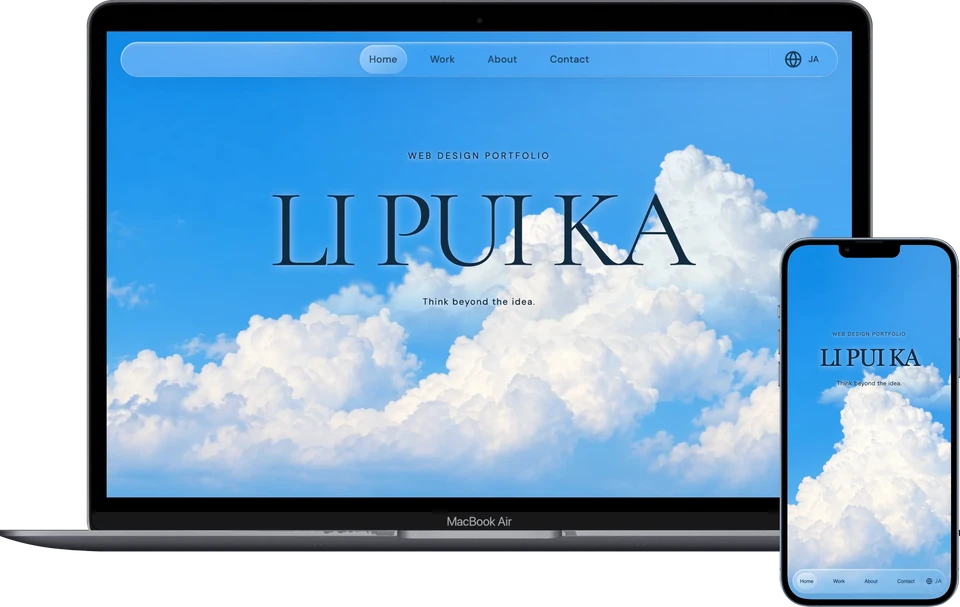

# Li Pui Ka — Portfolio

Web Designer / Web Creator / Digital Designerを目指して制作したポートフォリオサイトです。
学校で制作したWebサイトと、このポートフォリオを含む8作品を掲載しています。各作品では、制作目的、対象ユーザー、担当範囲、情報の整理やデザインで考えたことを紹介しています。



**公開サイト：** [li-kaka.github.io/Portfolio](https://li-kaka.github.io/Portfolio/)

## 制作の目的

作品の見た目だけでなく、どのような意図で制作したかも伝えることを目指しました。作品紹介に加え、Aboutでこれまでの経歴とWebデザインを学び始めたきっかけ、制作で大切にしていることをまとめています。

## 制作で担当したこと

サイト構成、素材の選定、ビジュアルとインタラクションの方向づけ、画面の確認と調整方針の検討を担当しました。制作にはCodexを活用し、デザイン案、文章の整理、HTML・CSS・JavaScriptの実装について支援を受けました。

## デザインで考えたこと

すっきりとした印象を保ちながら、内容が伝わり、単調にならないサイトを目指しました。雲の写真と透明感のあるUIで雰囲気をつくり、作品ごとの目的や内容をわかりやすく伝えることを大切にしました。

制作中は、情報の並びや操作の流れを実際の画面で繰り返し確認しました。読み進めにくい箇所や伝わりにくい表現を見直し、Codexに修正を依頼して再確認する作業を重ねました。

## 主な機能

- 日本語・英語・繁体字中国語の切り替え。初回表示は日本語で、Aboutと作品の説明を中心に翻訳しています。
- 単一のテーマと、言語の選択の保存。ポインター位置に追従する光沢ガラスの反射。
- パソコンでは、作品の番号選択とスクロールによるShowcase表示と、All worksの一覧表示を切り替えられます。
- スマートフォンでは一覧だけを表示し、通常のスクロールで作品を探せます。
- パソコン・タブレット・スマートフォンに合わせたレイアウト。
- Homeの開場演出は初回約3.9秒、同じページ内での再訪は約1.55秒。EscapeまたはTabで終了できます。画像とフォントの待機を含め、最大6秒で解除します。
- 開場中は隠れたナビゲーションと本文をinertにし、不可視の要素にキーボードフォーカスが入るのを防ぎます。
- Aboutの興味タグをホバー・フォーカス・タップすると、対応する写真が円形の枠に表示されます。香港出身のタグで元の写真に戻ります。
- キーボード操作時のフォーカス表示と、動きを減らす設定への対応。

## 使用技術

HTML / CSS / JavaScript（vanilla JavaScript）

フレームワークを使わず、共通のスタイルとスクリプトで各ページを構成しています。表示用画像にはWebPを使用し、長いデザイン画像は分割して読み込んでいます。

## ローカルでの確認

ビルドやパッケージのインストールは不要です。ローカルサーバーでプロジェクトのフォルダを開き、`index.html`を表示してください。

Python 3が使える場合は、プロジェクトのフォルダで次を実行します。

```sh
python3 -m http.server 8000
```

ブラウザで <http://localhost:8000/> を開きます。サーバーを終了するには、実行したターミナルで `Ctrl+C` を押してください。

## ファイル構成

```text
index.html              # トップページ
work01.html–work08.html  # 作品の詳細ページ
css/                    # 共通・レスポンシブ・詳細ページのスタイル
js/                     # 表示切り替え、言語、開場、スクロール、写真プレビュー
image/optimized/        # WebP画像と画像情報のmanifest
scripts/                # 画像の書き出し用スクリプト
PORTFOLIO_BRIEF.md       # デザイン方針と保守のための記録
```

元の大きなPNG・JPEGはローカルで保管し、公開ページでは圧縮した画像を参照します。サイトの閲覧には、同梱のWebP画像を使用します。画像を再書き出しする場合は、元画像とPillowが必要です。

## 制作者・連絡先

**Li Pui Ka / リプイカ** — 香港出身、東京在住。HAL東京でWebデザインを学んでいます。

- Email: [li.kaka.tokyo@gmail.com](mailto:li.kaka.tokyo@gmail.com)
- Instagram: [kaka.webdesign](https://www.instagram.com/kaka.webdesign/)
- LinkedIn: [Pui Ka Li](https://www.linkedin.com/in/pui-ka-li-7a196a3a8/)
- GitHub: [li-kaka](https://github.com/li-kaka)

掲載作品の制作範囲や使用素材については、各作品の詳細ページをご覧ください。

## 2026年10月のUI改修

雲の背景・前景と6枚のAbout写真は、元素材の合計24,598,621 bytesからWebPの合計1,219,074 bytesへ縮小しました。これは素材ファイルの比較であり、ページ全体の通信量や読み込み時間の計測結果ではありません。

作品8は更新したmockup08でDesktopとMobileの表示を紹介しています。Final designの画面集は掲載していません。作品の目的・担当範囲と実装支援については詳細ページで説明しています。サイト内にユーザーテストや商業的成果の実績を追加していません。
