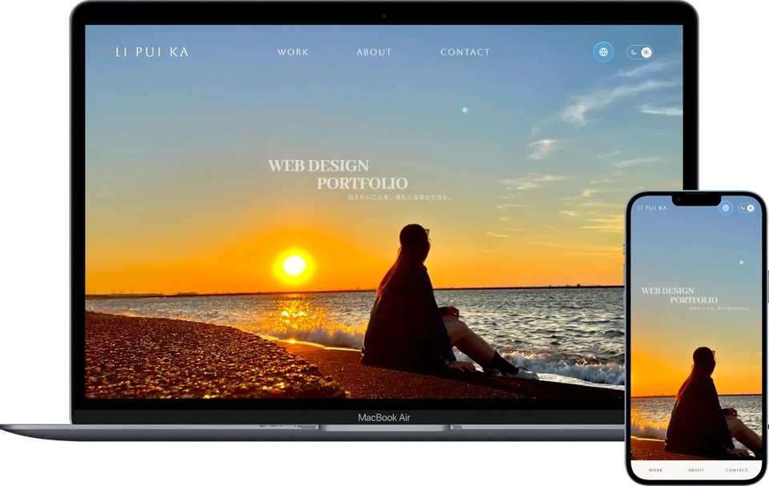

# Li Pui Ka — Portfolio

Web Designer / Web Creator / Digital Designerを目指して制作したポートフォリオサイトです。
学校で制作したWebサイトと、このポートフォリオを含む8作品を掲載しています。各作品では、制作目的、対象ユーザー、担当範囲、情報の整理やデザインで考えたことを紹介しています。



**公開サイト：** [li-kaka.github.io/Portfolio](https://li-kaka.github.io/Portfolio/)

## 制作の目的

作品の見た目だけでなく、どのような意図で制作したかも伝えることを目指しました。作品紹介に加え、Aboutでこれまでの経歴とWebデザインを学び始めたきっかけ、制作で大切にしていることをまとめています。

## デザインで考えたこと

### 一つずつ見る・一覧で見る

パソコンのShowcaseでは、中央の作品を大きく、前後の作品を小さく配置し、一つの作品に目が向くようにしました。一方で、全作品をすぐに確認したいユーザーもいるため、All worksの一覧へ切り替えられるようにしています。スマートフォンでは一覧だけを表示し、通常のスクロールで全作品を確認できます。

### 写真と文字のバランス

Heroには自分で撮影した海辺の写真を使い、自分らしさを伝えています。タイトルは空の余白にまとめ、文字の大きさや透明度を調整して、写真と文字のバランスを整えました。

### 見る順序に合わせた動き

最初に写真、そのあとにタイトルを表示します。スクロールするとHeroが上へ縮小しながら消え、作品紹介へつながります。Contactではメールアドレスを右から左へ見せる動きで、連絡先に目が向くようにしました。

## 主な機能

- 日本語・英語・繁体字中国語の切り替え。初回表示は日本語で、Aboutと作品の説明を中心に翻訳しています。
- ライトテーマ・ダークテーマの切り替えと、言語・テーマの選択の保存。
- パソコンでは、作品の番号選択とスクロールによるShowcase表示と、All worksの一覧表示を切り替えられます。
- スマートフォンでは一覧だけを表示し、通常のスクロールで作品を探せます。
- パソコン・タブレット・スマートフォンに合わせたレイアウト。
- キーボード操作時のフォーカス表示と、動きを減らす設定への対応。

## 使用技術

HTML / CSS / JavaScript（vanilla JavaScript）

フレームワークを使わず、共通のスタイルとスクリプトで各ページを構成しています。表示用画像にはWebPを使用し、長いデザイン画像は分割して読み込んでいます。

## ローカルでの確認

ビルドやパッケージのインストールは不要です。ローカルサーバーでプロジェクトのフォルダを開き、`index.html`を表示してください。

Python 3が使える場合は、プロジェクトのフォルダで次を実行します。

```sh
python3 -m http.server 8000
```

ブラウザで <http://localhost:8000/> を開きます。サーバーを終了するには、実行したターミナルで `Ctrl+C` を押してください。

## ファイル構成

```text
index.html              # トップページ
work01.html–work08.html  # 作品の詳細ページ
css/                    # 共通・レスポンシブ・詳細ページのスタイル
js/                     # 表示切り替え、言語、テーマ、アニメーション
image/optimized/        # WebP画像と画像情報のmanifest
scripts/                # 画像の書き出し用スクリプト
PORTFOLIO_BRIEF.md       # デザイン方針と保守のための記録
```

元の大きなPNG・JPEGはローカルで保管し、Gitには含めていません。サイトの閲覧には、同梱のWebP画像を使用します。画像を再書き出しする場合は、元画像とPillowが必要です。

## 制作者・連絡先

**Li Pui Ka / リプイカ** — 香港出身、東京在住。HAL東京でWebデザインを学んでいます。

- Email: [li.kaka.tokyo@gmail.com](mailto:li.kaka.tokyo@gmail.com)
- Instagram: [kaka.webdesign](https://www.instagram.com/kaka.webdesign/)
- LinkedIn: [Pui Ka Li](https://www.linkedin.com/in/pui-ka-li-7a196a3a8/)
- GitHub: [li-kaka](https://github.com/li-kaka)

掲載作品の制作範囲や使用素材については、各作品の詳細ページをご覧ください。
